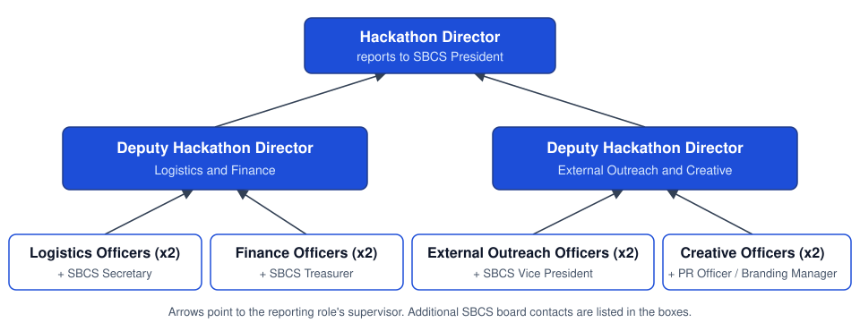

# Hackathon Committee Constitution

## General Requirements

1. All members of the hackathon committee must:
   - **a.** Be a matriculated student enrolled at Stony Brook University working towards an undergraduate degree, from the time of being appointed to the time of the hackathon
   - **b.** Hold only 1 position within SBCS (including executive board, non-executive board, and any committees, but excluding Reps) unless approved otherwise by SEA.
     - **i.** A Hackathon Committee Member can be both a Rep for SBCS and a committee member.
   - **c.** Be in good standing with the University. Sanctions of University Probation or higher, or a sanction restricting participation in clubs/organizations or from holding leadership positions, disqualify students from serving in an executive board or leadership position.
   - **d.** Have at least a 2.5 GPA
   - **e.** Serve as a committee member from the time they are appointed to the conclusion of the hackathon
     - **i.** If a committee member is set to graduate before the conclusion of the hackathon, they are prohibited from being a committee member
2. The Hackathon Committee will comprise of the following positions: Hackathon Director, Hackathon Logistics Officers (x2), Hackathon Finance Officers (x2), Hackathon Communications Officers (x2), Hackathon Creative Director, Hackathon Creative Officers (x2).
   - **a.** These positions will be referred to as the position titles but may omit the "Hackathon" part of the name for ease of use.
3. The Hackathon Committee must meet regularly, independent of the SBCS e-board, to discuss proceedings related to the hackathon. The SBCS Core 4 must also be present at these meetings (see Article VII of the SBCS Constitution).
4. Members of the Hackathon Committee are prohibited from running in SBCS Elections in the spring unless they resign from the committee upon being elected to a new position.
   - **a.** In the event a Hackathon Committee member resigns, a new member will be appointed through a selection process called upon by either the Hackathon Director or the SBCS President.
5. Relationship between SBUHacks and SBCS
   - **a.** It is in SBUHacks' best interest to be run by its own leadership, its own "Core 4", interviewed and selected by the SBCS executive board and the previous Hackathon Committee (see Hackathon Committee Selection Process).
   - **b.** For the longevity of both organizations and their community, SBUHacks and SBCS shall not split apart. On its own, SBUHacks is a one-time event and workload; as part of SBCS, it gains a lasting community and history.

## Committee Hierarchy

1. The Hackathon Committee hierarchy defines who reports to who and who will pick up responsibilities in the event a committee member becomes unable to fulfil their duties.
2. See the below diagram that visualizes this hierarchy. Arrows pointing to a top position from a bottom position represent the bottom position reporting to the top position. The top position will pick up the responsibilities if the bottom position is unable to do so until a new committee member can be appointed.

## Hackathon Director

- **a.** The Hackathon Director is considered a member of the non-executive board for SBCS, and as such, must also fulfill the general requirements of the non-executive board.
  - **i.** The Hackathon Director is required to attend weekly meetings with the rest of the executive board.
- **b.** The Hackathon Director must communicate to the rest of the executive board on all proceedings and planning happening within the hackathon committee.
- **c.** The Hackathon Director must oversee the hackathon committee, lead committee meetings, review all proceedings related to the hackathon, delegate tasks to the committee as necessary, and ensure the committee is meeting required deadlines.
- **d.** The Hackathon Director must also communicate with any external sponsors with the help of the Communications Officers.
- **e.** All members of the Hackathon Committee will report to the Hackathon Director. If any committee member is unable to fulfill their responsibilities, the Hackathon Director will be in charge of the respective responsibilities until a new committee member can be appointed.
- **f.** The Hackathon Director will report to the SBCS President. If a Hackathon Director is unable to fulfill their responsibilities, the SBCS President will be in charge of director's responsibilities until a new one can be appointed in a special election process called by the SBCS President

## Logistics Officers

- **a.** There will be 2 Logistics Officers
- **b.** The Logistics Officers will be responsible for organizing the hackathon schedule, coordinating with event volunteers, coordinating collaborating clubs/on-campus organizations, creating and maintaining the hackathon Devpost, and creating the hackathon Discord.
- **c.** The Logistics Officers will report to the Hackathon Director and the SBCS Secretary

## Finance Officers

- **a.** There will be 2 Finance Officers.
- **b.** The Finance Officers will be responsible for laying out the hackathon budget, prepping grant materials and presenting to the USG, and drafting invoice/placing orders.
- **c.** The Finance Officers will be responsible for communicating with external vendors regarding hackathon-related orders.
- **d.** The Finance Officers will be responsible for communicating with the SBCS Treasurer in regards to invoices, grants, and any usage of SBCS funds.
- **e.** The Finance Officers will report to the Hackathon Director and the SBCS Treasurer.

## Communications Officers

- **a.** There will be 2 Communication Officers.
- **b.** The Communications Officers will be responsible for handling student inquiries about the event, procuring and coordinating judges, and communicating with venue management.
- **c.** The Communications Officers will also be responsible for assisting the Hackathon Director in communication with external sponsors
- **d.** The Communications Officers will report to the Hackathon Director and SBCS Vice President.

## Creative Director

- **a.** There will be only 1 Creative Director
- **b.** The Creative Director will be responsible for proposing a theme, reviewing all media/art, and advertising the hackathon.
- **c.** The Creative Director will oversee the Creative Officers. In the event a Creative Officer is unable to perform their duties, the responsibilities will fall on the Creative Director.
- **d.** The Creative Director will report to the Hackathon Director.
- **e.** SBCS will help promote the hackathon, but all hackathon posts must come from a separate SBUHacks account so that SBCS's own accounts can continue with normally planned club activities.

## Creative Officers

1. There will be 2 Creative Officers.
2. The Creative Officers will be responsible for designing all art, creating promotional videos/photos, and posting information about the hackathon to all of the SBUHacks social media platforms (e.g. Instagram, Discord, LinkedIn, etc).
3. The Creative Officers may also assist the Logistics Officers in creating the Devpost and Discord for the hackathon.
4. The responsibilities of the Creative Officers may be divided between the 2 officers as per the skills, experiences, and workloads of the officers.
5. The Creative Officers will report to the Creative Director and the Hackathon Director in this order. In the event, a Creative Officer is unable to fulfill their responsibilities, the responsibilities will fall on the Creative Director until a new officer can be appointed.

## Hackathon Committee Selection Process

1. The Hackathon Committee will be decided through an interview process conducted by the SBCS executive board and any previous Hackathon Committee members from the year prior that are not re-applying. This group of people will be referred to as the interviewers.
2. This interview process must happen upon the conclusion of previous iteration of the hackathon
3. The interview process will follow the basic steps:
   - **a.** Each applicant will be reviewed and may be offered an interview based on the judgements of the interviewers.
   - **b.** At each interview for an applicant, at least 2 interviewers must be present.
   - **c.** Interview questions for each applicant will consist of general questions and questions specific to the role(s) to which the applicant is being considered for.
   - **d.** Notes will be taken at each interview and presented to the rest of the interviewers.
   - **e.** Based on the applications and interviews for each applicant, the Hackathon Committee will be decided by the interviewers in the following order:
     - **i.** Hackathon Director
     - **ii.** Creative Director
     - **iii.** Creative Officers
     - **iv.** Logistics Officers
     - **v.** Finance Officers
     - **vi.** Communications Officers
4. Any applicant for the Hackathon Committee must:
   - **a.** Apply for a maximum of 3 positions and rank their choices in order of preference
   - **b.** Fulfill the requirements of the Hackathon Committee to be considered
   - **c.** Understand that they are prohibited from running in SBCS Elections in the spring unless they are preparing to give up their current role
