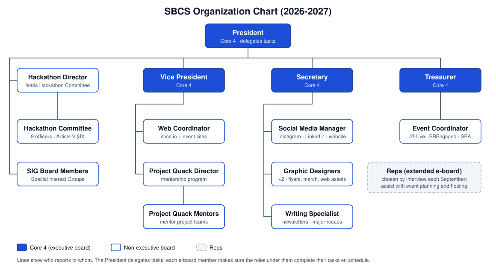

# Constitution
This repository serves as the official, version-controlled home of the Stony Brook Computing Society (SBCS) Constitution. By storing the constitution in GitHub, we ensure that all updates, amendments, and structural changes to the organization are recorded transparently and collaboratively. After all, we are doing computer science stuff.

## Current versions

| Document | Read on GitHub | PDF |
| --- | --- | --- |
| **SBCS Constitution (2026-2027)** | [`SBCS-Constitution.md`](SBCS-Constitution.md) | [`SBCS-Constitution.pdf`](SBCS-Constitution.pdf) |
| **Hackathon Committee Constitution** | [`Hackathon-Committee-Constitution.md`](Hackathon-Committee-Constitution.md) | [`Hackathon-Committee-Constitution.pdf`](Hackathon-Committee-Constitution.pdf) |

The current documents always live at the repo root under these fixed names, so links to them never break.

## Organization chart



**Core 4** (the executive board) is the President, Vice President, Secretary, and Treasurer. The President delegates tasks, and each Core 4 member makes sure the non-executive roles under them complete their tasks on schedule. For example, the Event Coordinator reports to the Treasurer (Article IV, Section V). See [Article V, Section IX.A](SBCS-Constitution.md#section-ixa-committee-hierarchy) for the Hackathon Committee's internal hierarchy.

## Markdown is the source; PDFs are generated

The Markdown files are the source of truth. Edit them, never the PDFs, so every amendment shows up as a readable line-by-line diff in its PR. The PDFs are rendered from the Markdown:

```bash
./scripts/build-pdf.sh                      # rebuild all current PDFs
./scripts/build-pdf.sh SBCS-Constitution.md # rebuild one
```

This requires [pandoc](https://pandoc.org/) and Google Chrome or Chromium. Page styling lives in `scripts/pdf.css`. Commit the regenerated PDF in the same PR as the Markdown change.

## Repository structure

```
Constitution/
├── README.md
├── SBCS-Constitution.md                   ← current SBCS Constitution (2026-2027), source
├── SBCS-Constitution.pdf                  ← generated from the .md
├── Hackathon-Committee-Constitution.md    ← current Hackathon Committee Constitution, source
├── Hackathon-Committee-Constitution.pdf   ← generated from the .md
├── assets/                                ← logo, org chart, hackathon hierarchy (SVG)
├── scripts/                               ← build-pdf.sh + pdf.css
├── SpecialInterestGroup/                  ← SIG proposals and documentation
└── archive/
    └── 2025-2026/
        └── SBCS-Constitution.md           ← previous SBCS Constitution
```

## Archiving a version

When a new version is adopted (e.g. at the start of the academic year):

1. Create `archive/<year>/` for the academic year the outgoing version was in effect (e.g. `archive/2026-2027/`).
2. Move the outgoing `.md` and `.pdf` files into that folder, keeping their file names.
3. Put the new versions at the repo root under the same fixed names, then run `./scripts/build-pdf.sh`.
4. Update the year in **Current versions** above and tag the release (see **Versioning** below).

## Branch & PR conventions

### Branch name
- `amendment/<short-name>`
  - e.g. `amendment/eboard-roles-update`, `amendment/membership-eligibility`

### PR title
- `[Amendment Name] Brief description`
  - e.g. `[PR Avengers] Update Marketing Team Names`

### PR description
- 2–4 bullet summary of changes  
- Short rationale  
- Note any impact on elections, membership, or finances  

## Review & voting

1. Open a PR with the amendment.  
2. Discuss in comments (questions, suggestions, edits).  
3. Update the PR to the final wording.  
4. Hold a formal vote at election night (or another designated meeting).  
5. If it passes, an authorized officer merges to `main`.  
6. If it fails, close the PR (keep it for history).  

## Versioning

Use annotated tags to mark major states of the Constitution.

### Tag format
- `v<year>.<major>.<minor>`
  - e.g. `v2025.1.0`

### When to bump
- **Major** – structural changes (new roles, election rules)  
- **Minor** – clarifications, small policy changes  
- **Patch** – typos, formatting, non-substantive edits  
