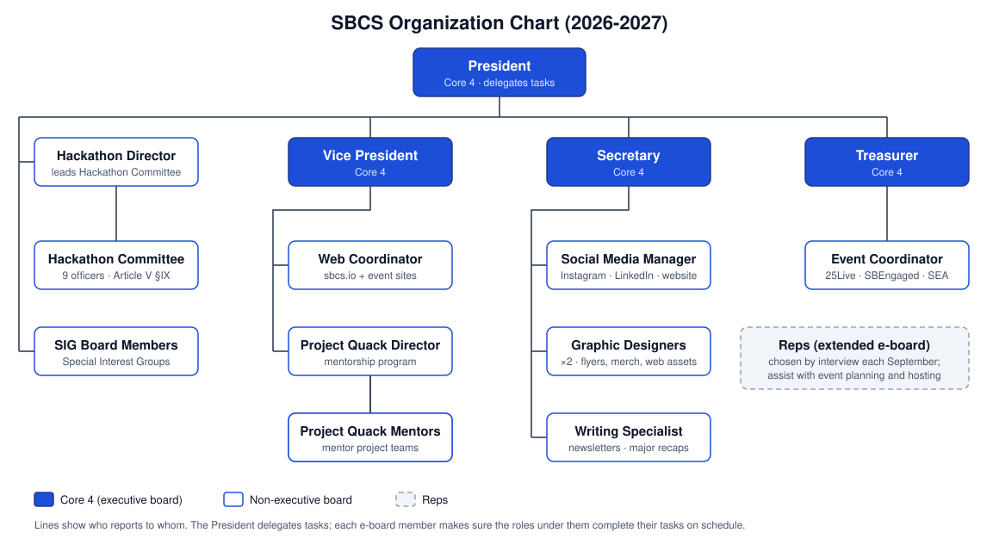
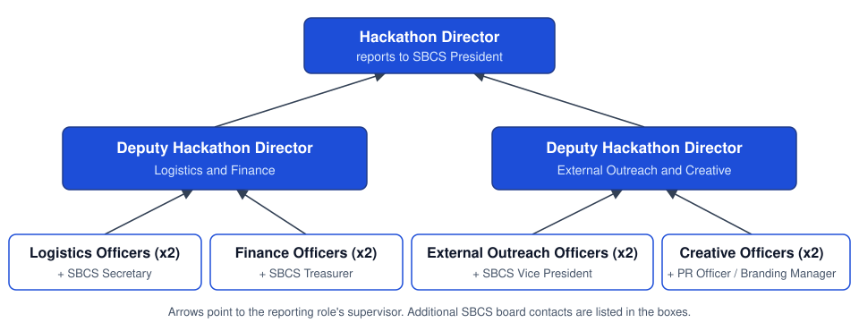

# SBCS Constitution (2026-2027)

## Organization Chart

## Article I – The Stony Brook Computing Society

The full name of this organization shall be the Stony Brook Computing Society (hereafter referred to as the 'SBCS'). The SBCS is registered with the College of Engineering and Applied Sciences and the Department of Student Engagement and Activities."

## Article II – Statement of Purpose

### Section I

SBCS fosters a community for anyone interested in technology. We provide academic, professional, and social events so students can grow as both programmers and people. Our industry connections, destressing games, and educational workshops serve your success.

### Section II

1. To help our members, and students at Stony Brook, better their technology education both inside and outside the classroom.
2. To facilitate our members' transition from school to the technology industry, we are creating opportunities to learn about potential careers, preparing students for interviews and career fairs, and connecting students with potential jobs.
3. We aim to encourage positive relationships among our students, with their diverse backgrounds and interests, that will persist throughout their college careers and afterward.

The purpose of the "Stony Brook Computing Society" is to foster a community for anyone interested in technology. We provide academic, professional, and social events so one can grow as both a programmer and a person. Our industry connections, destressing games, and educational workshops serve your success.

"Stony Brook Computing Society", as a registered organization at Stony Brook University, is committed to promoting a safe and vibrant campus community. The leaders and members of "The Stony Brook Computing Society" also agree to abide by the Stony Brook University Code of Student Responsibility, University policies, and Federal, New York State, and Local laws.

Therefore, the rules, regulations, and policies of Stony Brook University shall supersede any terms or processes outlined in this constitution.

## Article III – Membership

### Section I

- **a.** The focus of the Stony Brook Computing Society (SBCS) shall be to serve all student populations with a primary focus on undergraduate students. Active membership must be limited to currently enrolled students at Stony Brook University (SBU). The Stony Brook Computing Society is open to all students, irrespective of their fields of study, fostering a community that thrives on diversity and a shared interest in technology.
- **b.** No person shall be denied membership or office because of sexual orientation, nation of origin, race, sex, physical disability, political or religious beliefs, and all other protected classes under federal and state laws.
- **c.** Non-University members may participate, but may not act on behalf of the organization or perform any of the following functions: Holding office in the organization; Presiding, officiating, voting, or making/seconding motions at any meeting of the organization; Soliciting funds on campus on behalf of the organization; Working at tables/events on the campus on behalf of the organization unless a student member or University faculty/staff is at all times present and responsible for the activity.

### Section II

Active members are classified as members who have attended at least 3 events, GBMs, or SBCS events in the last year or this current semester.

## Article IV – Executive Board Positions

### Section I: General Requirements

- **a.** The executive board is defined as the President, Vice President, Treasurer, and Secretary. These executive board members must:
  - **i.** Hold only one position on the board unless otherwise approved by SEA in writing
  - **ii.** Be matriculated, currently enrolled, and working toward an undergraduate degree relevant to the organization they represent unless otherwise approved by SEA in writing.
  - **iii.** Be in good standing with the University. Sanctions of University Probation or higher, or a sanction restricting participation in clubs/organizations or from holding leadership positions, disqualify students from serving in an executive board or leadership position.
  - **iv.** Maintain at least a 2.25 cumulative GPA.
- **b.** All officers shall serve for 1 academic year and may be re-elected at the end of their term, provided they maintain the requirements noted above.

### Section II: Organization

- **a.** The total membership of the executive board shall not exceed 50% of the members of the organization.

### Section III: President

- **a.** The President shall be the official representative of the organization; he/she shall also be a non-voting, ex-officio member of all committees of the organization. The President shall be the chairperson and presiding officer of the executive board.
- **b.** The President shall have the power to convene and preside over the meetings of the executive board and the general body, as well as prepare the agenda for the respective meetings.
- **c.** The President shall work together with the E-Board to delegate the work of the E-Board.
- **d.** The President will be in charge of updating our advisors about our club and moderating communications with sponsors and external companies.
- **e.** The President shall oversee the Special Interest Group board members
- **f.** The President shall further perform such duties as may be necessary and proper in the fulfillment of their office, subject to the approval of the executive board.

### Section IV: Vice President

- **a.** The Vice President shall be required to see that standing committee chairpersons are fulfilling their duties.
- **b.** The Vice President shall work with other clubs and organizations on campus, including, but not limited to, the Career Center and the CS Department, to connect SBCS and its members to other events that can be of benefit to members.
- **c.** The Vice President shall further perform such duties as may be necessary and proper in the fulfillment of his/her office, subject to the approval of the executive board.
- **d.** If the President is unable to perform his/her duties (due to impeachment, leave of absence, or resignation), the Vice President shall assume the position of the President.
- **e.** If the Vice President is unable to perform their duties (due to leave of absence, resignation, or impeachment), a new Vice President will be elected in a special election called by the President.

### Section V: Treasurer

- **a.** The Treasurer shall keep a detailed record of all monies allotted to the organization. The Treasurer shall also submit all payment requests.
- **b.** The Treasurer shall perform such duties as may be necessary and proper in the fulfillment of his/her office, subject to the approval of the executive board.
- **c.** If the Treasurer is unable to perform their duties (due to leave of absence, resignation, or impeachment), a new Treasurer will be elected in a special election called by the President.
- **d.** The Event Coordinator reports to the Treasurer.

### Section VI: Secretary

- **a.** The Secretary shall take minutes and attendance of all meetings and maintain an up-to-date active voting membership roster.
- **b.** The Secretary shall send out a weekly email, which outlines the agenda of the upcoming meeting, one school day before the meeting.
- **c.** If the Secretary is unable to perform their duties (due to leave of absence, resignation, or impeachment), a new Secretary shall be elected in a special election called by the President
- **d.** The Webmaster reports to the Secretary.

## Article V – Non-Executive Board Positions

### Section I: General Requirements

- **a.** Non-executive board positions include the Branding Manager, Social Media Manager, Event Coordinator, Web Coordinator, Project Quack Director, and QuackHacks Director.
- **b.** Non-executive board positions must report to one of the executive board members, as identified in the executive board members' responsibilities.
- **c.** Members holding a non-executive board position hold specific responsibilities with the organization, however, they are not a part of the executive board.
- **d.** Members holding a non-executive board position must be matriculated, currently enrolled, and working toward an undergraduate degree unless otherwise approved by SEA in writing.
- **e.** All non-executive board positions shall serve for 1 academic year.

### Section II: The PR Officer

1. The PR Officer will be a full-fledged e-board member of SBCS. They must fulfill all of the requirements of a normal e-board member and must fulfill the following responsibilities:
   - **a.** Attend weekly e-board meetings and update the SBCS e-board with updates regarding the PR team.
   - **b.** Meet frequently with the PR team, draft agendas, and lead meetings.
   - **c.** Oversee all proceedings related to marketing and public relations within SBCS.
2. All members of the PR team will report to the PR Officer. If any committee member is unable to fulfill their responsibilities, the PR Officer (in conjunction with the Branding Manager) will be in charge of the respective responsibilities until a new committee member can be appointed.
3. The PR Officer is responsible for overseeing the Social Media Manager, Event Photographer, and Internal Promotions Manager roles.

### Section III: Branding Manager

1. The Branding Manager will be a full-fledged e-board member of SBCS. They must fulfill all of the requirements of a normal e-board member and must fulfill the following responsibilities:
   - **a.** Attend weekly e-board meetings and update the SBCS e-board with updates regarding the PR team.
   - **b.** Meet frequently with the PR team, draft agendas, and lead meetings.
   - **c.** Oversee all proceedings related to creative direction and branding within SBCS.
2. All members of the PR team will report to the Branding Manager. If any committee member is unable to fulfill their responsibilities, the Branding Manager (in conjunction with the PR Officer) will be in charge of the respective responsibilities until a new committee member can be appointed.
3. The PR Officer is responsible for overseeing the Writing Specialist and Graphic Designer roles.

### Section IV: Social Media Manager

1. The Social Media Manager is responsible for
   - **a.** Managing SBCS Social Media as a representative of the organization.
     - **i.** Interacting with posts (responding to comments, reposting tagged posts, etc).
     - **ii.** Responding to Direct Messages.
   - **b.** Creating engaging short-form content in the form of reels or TikToks.
   - **c.** Creating engaging long-form content such as documentary/vlog style videos of large scale events.
   - **d.** Managing and moderating the SBCS Discord server.
   - **e.** Documenting SBCS Events through photos and videos.
     - **i.** Photographing important events for later usage (newsletter, social media, etc)
     - **ii.** Videographing important moments such as award ceremonies.
     - **iii.** Posting real-time event updates on social media
     - **iv.** Conduct impromptu interviews with members for content
2. Report to the PR Officer and Vice President.

### Section V: Internal Promotions Manager

1. The Internal Promotions Manager is responsible for
   - **a.** Reaching out to other organizations to promote SBCS events including, but not limited to:
     - **i.** Other Stony Brook University Clubs
     - **ii.** Professors and University Departments (e.g. CEAS)
     - **iii.** Other universities and external organizations (incl. Outside Stony Brook University) with explicit approval of the SBCS executive board.
   - **b.** Coordinate with professors to organize Class Visits
     - **i.** Class visits are defined as promotional presentations in front of a class of students.
     - **ii.** Class visits are conducted at the beginning of each semester, and before major events (e.g. SBUHacks, collaborations with external organizations).
   - **c.** Organize Flyer distribution and physical marketing
     - **i.** Schedule E-Board members (incl. Non SBCS PR) for printing and posting duties.
     - **ii.** Fill any gaps in posting schedules.
2. Report to the PR Officer and Vice President.

### Section VI: Graphic Designer

1. The Graphic Designer is responsible for
   - **a.** Designing any graphics for SBCS promotion. Including but not limited to
     - **i.** Flyers
     - **ii.** Social Media Graphics
     - **iii.** Merchandise
     - **iv.** Website GUI Assets
2. Report to the Branding Manager and Vice President

### Section VII: Writing Specialist

1. The Writing Specialist is responsible for
   - **a.** Managing the SBCS Newsletters: General, Alumni, Sponsor
     - **i.** Outsource writing tasks to Reps if possible
     - **ii.** Primary responsibility is editorial
   - **b.** Drafting and publishing regular LinkedIn updates for major events.
   - **c.** Drafting and publishing Discord announcements
2. Report to the Branding Manager and Vice President

### Section VIII: Event Coordinator

- **a.** The responsibilities of an Event coordinator include coordinating and planning SBCS events and collaborations, booking rooms on 25Live, submitting events on SBEngaged, and staying in contact with the club's program advisor from the Department of Student Engagement and Activities
- **b.** If the Event Coordinator is unable to perform their duties (due to leave of absence, resignation, or assumption of the presidency), a new Event Coordinator will be elected in a special election called by the President.
- **c.** The Event Coordinator reports to the Treasurer of this organization

### Section IX: Web Coordinator

- **a.** The responsibilities of the Web Coordinator include creating, maintaining, and designing the SBCS website (<https://sbcs.io/>), as well as any websites needed for SBCS events.
- **b.** If a Web Coordinator is unable to perform their duties (due to leave of absence, resignation, or assumption of the presidency), a new Web Coordinator will be elected in a special election called by the President.
- **c.** The Web Coordinator reports to the Secretary of this organization

### Section X: Project Quack Director

- **a.** The responsibilities of the Project Quack Director shall include forming teams for the Project Quack Mentorship Program, communicating clear project goals and milestones to all those involved, checking with all project groups, planning Project Quack-specific events and meetings, and relaying all operations related to Project Quack to the rest of the office.
- **b.** If a Project Quack Director is unable to perform their duties (due to leave of absence, resignation, or assumption of the presidency), a new Project Quack Director will be elected in a special election called by the President.

### Section XI: Reps

- **a.** Reps, short for representatives, are extended e-board positions that are elected through an interview process in the early fall of the academic year
- **b.** The responsibilities of a representative include assisting with event planning and hosting, which can involve coming up with event ideas, designing activities, and leading workshops.
- **c.** If a Representative is unable to perform their duties (due to leave of absence, resignation, or assumption of the presidency), a new Representative will be elected in another interview process called by the President.

### Section XII: Hackathon Committee

#### General Requirements

1. All members of the hackathon committee must:
   - **a.** Be a matriculated student enrolled at Stony Brook University working towards an undergraduate degree, from the time of being appointed to the time of the hackathon
   - **b.** Hold only 1 position within SBCS (including executive board, non-executive board, and any committees, but excluding Reps) unless approved otherwise by SEA.
     - **i.** A Hackathon Committee Member can be both a Rep for SBCS and a committee member.
   - **c.** Be in good standing with the University. Sanctions of University Probation or higher, or a sanction restricting participation in clubs/organizations or from holding leadership positions, disqualify students from serving in an executive board or leadership position.
   - **d.** Have at least a 2.5 GPA
   - **e.** Serve as a committee member from the time of their appointment until all hackathon-related responsibilities, including post-event duties, have been completed.
     - **i.** If a committee member is expected to graduate before the completion of all hackathon-related responsibilities, including post-event duties, they are ineligible to serve on the committee.
2. The Hackathon Committee will comprise of the following positions: Hackathon Director, Deputy Hackathon Directors (x2), Hackathon Logistics Officers (x2), Hackathon Finance Officers (x2), Hackathon External Outreach Officers (x2), Hackathon Creative Officers (x2).
   - **a.** These positions will be referred to as the position titles but may omit the “Hackathon” part of the name for ease of use.
3. The Hackathon Committee must meet regularly, independent of the SBCS e-board, to discuss proceedings related to the hackathon.
4. Members of the Hackathon Committee are prohibited from running in SBCS Elections in the spring unless they resign from the committee upon being elected to a new position.
   - **a.** In the event a Hackathon Committee member resigns, a new member will be appointed through a selection process called upon by either the Hackathon Director or the SBCS President.

### Section XII.A Committee Hierarchy

1. The Hackathon Committee hierarchy defines who reports to who and who will pick up responsibilities in the event a committee member becomes unable to fulfil their duties.
2. See the below diagram that visualizes this hierarchy. Arrows pointing to a top position from a bottom position represent the bottom position reporting to the top position. The top position will pick up the responsibilities if the bottom position is unable to do so until a new committee member can be appointed.

### Section XII.B Hackathon Director

1. The Hackathon Director is considered a member of the non-executive board for SBCS, and as such, must also fulfill the general requirements of the non-executive board.
   - **a.** The Hackathon Director is required to attend weekly meetings with the rest of the executive board.
2. The Hackathon Director must communicate to the rest of the executive board on all proceedings and planning happening within the hackathon committee.
3. The Hackathon Director must oversee the hackathon committee, lead committee meetings, review all proceedings related to the hackathon, delegate tasks to the committee as necessary, and ensure the committee is meeting required deadlines.
4. The Hackathon Director must also communicate with any external sponsors with the help of the External Outreach Officers.
5. All members of the Hackathon Committee will report to the Hackathon Director through their respective Deputy Hackathon Directors. If a committee member is unable to fulfill their responsibilities, the respective Deputy Hackathon Director will temporarily oversee those responsibilities until a replacement can be appointed. If a Deputy Hackathon Director is unable to fulfill their responsibilities, the Hackathon Director will be in charge of those responsibilities until a replacement can be appointed.
6. The Hackathon Director will report to the SBCS President. If a Hackathon Director is unable to fulfill their responsibilities, the SBCS President will be in charge of director’s responsibilities until a new one can be appointed in a special election process called by the SBCS President

### Section XII.C Deputy Hackathon Directors

1. There will be 2 Deputy Hackathon Directors.
2. One Deputy Hackathon Director will oversee the Logistics Officers and Finance Officers, while the other will oversee the External Outreach Officers and Creative Officers.
3. The Deputy Hackathon Directors will be responsible for supervising their respective officers, coordinating tasks, monitoring progress, and ensuring deadlines are met.
4. The Deputy Hackathon Directors will assist the Hackathon Director in planning and organizing the hackathon and carry out additional responsibilities as assigned by the Hackathon Director.
5. The Deputy Hackathon Director overseeing External Outreach and Creative will also be responsible for proposing the hackathon theme, reviewing promotional materials, and overseeing advertising efforts.
6. The Deputy Hackathon Directors will report directly to the Hackathon Director. If an officer is unable to fulfill their responsibilities, the respective Deputy Hackathon Director will temporarily oversee those responsibilities until a replacement can be appointed.

### Section XII.D Logistics Officers

1. There will be 2 Logistics Officers
2. The Logistics Officers will be responsible for organizing the hackathon schedule, coordinating with event volunteers, coordinating collaborating clubs/on-campus organizations, creating and maintaining the hackathon Devpost, and creating the hackathon Discord.
3. The Logistics Officers will report to the Deputy Hackathon Director overseeing Logistics and Finance, the Hackathon Director, and the SBCS Secretary.

### Section XII.E Finance Officers

1. There will be 2 Finance Officers.
2. The Finance Officers will be responsible for laying out the hackathon budget, prepping grant materials and presenting to the USG, and drafting invoice/placing orders.
3. The Finance Officers will be responsible for communicating with external vendors regarding hackathon-related orders.
4. The Finance Officers will be responsible for communicating with the SBCS Treasurer in regards to invoices, grants, and any usage of SBCS funds.
5. The Finance Officers will report to the Deputy Hackathon Director overseeing Logistics and Finance, the Hackathon Director, and the SBCS Treasurer.

### Section XII.F External Outreach Officers

1. There will be 2 External Outreach Officers.
2. The External Outreach Officers will be responsible for handling student inquiries about the event, procuring and coordinating judges, and communicating with venue management.
3. The External Outreach Officers will also be responsible for assisting the Hackathon Director in communication and outreach with external sponsors.
4. The External Outreach Officers will keep the Deputy Hackathon Director overseeing External Outreach and Creative and the Hackathon Director updated on all emails and tasks related to their responsibilities.
5. The External Outreach Officers will confirm all external communications with the Deputy Hackathon Director overseeing External Outreach and Creative and the Hackathon Director before they are sent.
6. The External Outreach Officers will report to the Deputy Hackathon Director overseeing External Outreach and Creative, the Hackathon Director, and the SBCS Vice President.

### Section XII.G Creative Officers

1. There will be 2 Creative Officers.
2. The Creative Officers will be responsible for designing all art, creating promotional videos/photos, and posting information about the hackathon to all social media platforms (e.g. Instagram, Discord, LinkedIn, etc).
3. The Creative Officers may also assist the Logistics Officers in creating the Devpost and Discord for the hackathon.
4. The responsibilities of the Creative Officers may be divided between the 2 officers as per the skills, experiences, and workloads of the officers.
5. The Creative Officers will report to the Deputy Hackathon Director overseeing External Outreach and Creative, the Hackathon Director, and the SBCS PR Officer/Branding Manager in this order. In the event a Creative Officer is unable to fulfill their responsibilities, the responsibilities will fall on that Deputy Hackathon Director until a new officer can be appointed.

### Section XII.H Hackathon Committee Selection Process

1. The Hackathon Committee will be decided through an interview process conducted by the SBCS executive board, the SBCS PR Officer, the SBCS Branding Manager, and any previous Hackathon Committee members from the year prior that are not re-applying. This group of people will be referred to as the interviewers.
2. This interview process must happen upon the conclusion of previous iteration of the hackathon
3. The interview process will follow the basic steps:
   - **a.** Each applicant will be reviewed and may be offered an interview based on the judgements of the interviewers.
   - **b.** At each interview for an applicant, at least 2 interviewers must be present.
   - **c.** Interview questions for each applicant will consist of general questions and questions specific to the role(s) to which the applicant is being considered for.
   - **d.** Notes will be taken at each interview and presented to the rest of the interviewers.
   - **e.** Based on the applications and interviews for each applicant, the Hackathon Committee will be decided by the interviewers in the following order:
     - **i.** Hackathon Director
     - **ii.** Deputy Hackathon Directors
     - **iii.** Logistics Officers
     - **iv.** Finance Officers
     - **v.** External Outreach Officers
     - **vi.** Creative Officers
4. Any applicant for the Hackathon Committee must:
   - **a.** Apply for a maximum of 3 positions and rank their choices in order of preference
   - **b.** Fulfill the requirements of the Hackathon Committee to be considered
   - **c.** Understand that they are prohibited from running in SBCS Elections in the spring unless they are preparing to give up their current role

### Section XII.I Committee Meetings and Attendance

1. The Hackathon Committee must meet at least once per week during the active planning period of the hackathon. The Hackathon Director may adjust the meeting frequency as necessary.
2. Attendance at committee meetings is mandatory for all Hackathon Committee members.
   - **a.** Absences may be excused for valid reasons, including academic obligations, illness, emergencies, or other circumstances approved by the Hackathon Director.
   - **b.** Committee members must notify the Hackathon Director or their respective Deputy Hackathon Director in advance if they are unable to attend a meeting.
   - **c.** Committee members who accumulate 3 unexcused absences during their term will be subject to a removal review in accordance with Section XII.J. This requirement does not supersede any additional attendance requirements established elsewhere in this Constitution.
3. Meeting minutes must be taken at every Hackathon Committee meeting, with the Deputy Hackathon Directors alternating responsibility for recording them.
   - **a.** Meeting minutes must include attendance, major discussion points, decisions made, and assigned tasks and deadlines.
   - **b.** Meeting minutes must be shared with all Hackathon Committee members within 48 hours after each meeting.
4. Meeting notes must also be taken during meetings with external sponsors, partners, and other organizations regarding hackathon-related matters.
   - **a.** The Hackathon Committee members participating in such meetings will be responsible for ensuring that notes are taken.
   - **b.** Meeting notes must include relevant discussion points, agreements made, and any follow-up actions or commitments.
   - **c.** Meeting notes must be shared with the Hackathon Director and relevant committee members within 48 hours after each meeting.

### Section XII.J Committee Member Removal and Vacancies

1. A Hackathon Committee member may be subject to removal for any of the following reasons:
   - **a.** Accumulating 3 unexcused absences from Hackathon Committee meetings during their term.
   - **b.** Repeatedly failing to fulfill assigned responsibilities or meet deadlines without a valid reason.
   - **c.** Failing to maintain the general requirements for committee membership outlined in Section XII.
   - **d.** Engaging in misconduct or behavior that negatively affects the operations of the Hackathon Committee.
2. A removal review may be initiated by the Hackathon Director or either Deputy Hackathon Director.
   - **a.** The committee member under review must be notified of the reasons for the proposed removal and given an opportunity to respond.
   - **b.** Any proposed removal must be referred to the SBCS Executive Board and handled in accordance with the applicable removal procedures outlined in Articles IX and X of this Constitution.
3. In the event of a committee member's removal or resignation, a replacement may be appointed through the selection process outlined in Section XII.H, subject to the special election requirement for the Hackathon Director in Section XII.B.
4. A removed or resigning committee member must transfer all relevant documents, accounts, and outstanding responsibilities to the Hackathon Director or their respective Deputy Hackathon Director.

### Section XII.K Committee Authority and Decision-Making

1. The Hackathon Committee will have primary responsibility for planning, organizing, and executing the hackathon, under the leadership of the Hackathon Director.
2. The Hackathon Director will oversee all hackathon-related operations, while the Deputy Hackathon Directors will oversee their respective areas of responsibility.
3. SBCS Executive Board members who are not part of the Hackathon Committee must consult with the Hackathon Director or the relevant Deputy Hackathon Director before making changes to hackathon-related operations, procedures, or responsibilities, regardless of the scale of the proposed changes.
4. Major decisions affecting multiple areas of the Hackathon Committee must be discussed with the Hackathon Director and the relevant Deputy Hackathon Directors before implementation.
5. Important operational decisions, changes to existing plans, and assigned responsibilities must be documented and made accessible to relevant Hackathon Committee members.

### Section XII.L Committee Transition and Handover

1. Outgoing Hackathon Committee members must complete all outstanding hackathon-related responsibilities, including post-event duties, before concluding their term.
2. Outgoing committee members must transfer all relevant documents, records, account access, contacts, and other materials to their successors or the Hackathon Director.
3. The outgoing Hackathon Director will be responsible for coordinating the transition between the outgoing and incoming Hackathon Committees.
4. Outgoing committee members must provide their successors with relevant information regarding their responsibilities, previous decisions, and recommendations for future hackathons.
5. The incoming Hackathon Committee may begin planning the next hackathon while the outgoing committee completes its remaining responsibilities.

## Article VI – Special Interest Groups

### Section I: General Requirements

- Non-executive board positions include Special Interest Group board members
- Special Interest Group board members must report to the President of this organization.
- Members holding a non-executive board position hold specific responsibilities with the organization, however, they are not a part of the executive board.
- Members holding a non-executive board position must be matriculated, currently enrolled, and working toward an undergraduate degree unless otherwise approved by SEA in writing.
- All non-executive board positions shall serve for one academic year.

### Section II: Responsibilities

- Special Interest Groups may be formed by members of this organization to serve as forums for discussion of appropriate specific computing interests
- Special Interest Groups can be created/determined based on the needs of the organization
- Special Interest Groups are sub-committees of this organization and will be named in the form "Computing Society X at Stony Brook," where X appropriately reflects the Special Interest Group's purpose. This name shall be used for all business of the Special Interest Group.

### Section III: Relationship with the Executive Board

- The Executive Board must support all Special Interest Groups equally in their endeavors by helping them secure meeting rooms, obtain necessary funding from the SBCS budget for activities as deemed appropriate by the Executive Board, and make their events and activities known to the General Body.
- Special Interest Groups may request funding from this organization's budget, and receive organizational assistance from this organization's members and executive board.
- Special Interest Groups' requests for funding must be approved by 3/4 of the Executive Board, and can then be added to this organization's budgetary request following official CEAS or SBLife policies.

### Section IV: Structure of Special Interest Groups

- **a.** Special Interest Groups shall elect an Executive Board of at least a President and Vice President to plan their meetings and activities and report to the General Body. Members of SBCS's Executive Board may not be on any Special Interest Group's Executive Board, though they can be active members of any Special Interest Group, as they must advise and assist all Special Interest Groups equally.
- **b.** To keep their status, Special Interest Groups must have at least 3 activities or meetings per semester and must send an informed representative (such as an Executive Board member) to each General Body Meeting of this organization to update the General Body members on their events and activities.
- **c.** If a Special Interest Group fails to elect a full Executive Board, hold three (3) meetings or activities, including joint activities with this organization, other SIGs, or other organizations, or fails to send a representative to General Body meetings five (5) times during a semester, it shall be considered defunct and may not operate or receive funding until it is formally re-formed.

### Section V: Creation of Special Interest Groups

- **a.** A Special Interest Group can be formed at any time during the semester, and request funding at the beginning of the next semester after it was formed in time for the official organization budget to be made.
- **b.** To be formed, Special Interest Groups must be proposed by an interested student and approved by three-quarters (3/4) of the Executive Board.
- **c.** To be voted upon, a Special Interest Group must have a name, a brief statement of purpose, and a proposed Executive Board (if a SIG is proposed at any other time than at the beginning of a semester, its Executive Board shall continue through the next semester).

## Article VII – Meetings

- **a.** This organization shall hold a General Body Meeting weekly if possible, and at least one General Body meeting each month during the Fall or Spring semester is in session.
- **b.** A quorum consisting of a majority of the total active voting membership is necessary for the transaction of any business at all meetings.
- **c.** All meetings must have an agenda and five (5) school days prior notice of the meetings must be given to all organization members.

## Article VIII – Elections

### Section I: Executive Board Selection

- **a.** Officers of the Executive Board shall be determined by an election with the active body that is eligible to vote.
- **b.** No person shall seek a position on the executive board unless they have been an active member of this organization for at least one semester before the semester when they would assume office.
- **c.** Nomination Process
  - **i.** Nominees for office must fulfill the general requirements for being elected/appointed to office.
  - **ii.** Nominations must be submitted/take place a minimum of one week prior to the selection of officers.
  - **iii.** Nominations can be made by either
    1. Executive Board Member at a general body meeting
    2. General Body Members at a general body meeting
  - **iv.** Self Nominations are permitted
  - **v.** All nominees will be allowed to accept or decline the nomination(s)
- **d.** Election Process

  No person shall be elected to more than one executive board position at any given term.

  - **i.** An election is won by a simple majority vote (50% +1) of the active members present at the election. A quorum is required.
  - **ii.** Officers shall be elected in the following order President, Vice President, Secretary, Treasurer
  - **iii.** Nominees shall be called in alphabetical order to the order of the position, all other nominees shall leave the room until called in by the President or their designee
  - **iv.** Nominees shall be able to speak about their qualifications and desires for the position for a maximum of two minutes.
  - **v.** After all nominees for the positions have spoken about their qualifications and character for the position, active members may ask questions to the nominees to help solidify their vote for the position.
  - **vi.** Elections must be held no later than April.
  - **vii.** Elections shall be conducted through anonymous ballot, done virtually through the SBEngaged Elections Tab or in person.
  - **viii.** In the event a simple majority is not reached, the top two candidates shall be allowed to speak for 1 additional minute and a new ballot shall be collected.
  - **ix.** Once all positions have been filled through the completion of the Election Process, the change shall be recorded in the minutes, and submitted on SBEngaged through the Executive Board Update form.
- **e.** New officers shall assume their position on June 1st.
  - **i.** In between elections and new officers assuming their positions, the incumbent executive board will maintain oversight of the organization.

### Section II: Non-Executive Board Position Selection

- **a.** Non-Executive Board Positions shall be determined by an appointment by an executive board member
- **b.** Elections must be held as needed, depending on the organization's interest in special interest groups.
- **c.** To conduct elections for these positions, please refer to the outlined process that is used for Executive Board Positions.
- **d.** New non-executive board members shall assume their position on June 1st.

### Section III: Reps Selection

- **a.** Reps shall be selected through an interview process in September of each academic year.
- **b.** Reps shall be nominated, either by themselves or by another person, through a Google Form submission
  - **i.** Nominees must fulfill the general requirements for being elected to office
  - **ii.** Nominations must take place at least 1 week before the interview process begins
- **c.** The Rep interview process begins after the deadline has passed; the deadline is set at the discretion of the President.
  - **i.** The interview process consists of at least 2 executive board members asking questions to each nominee regarding their desire to come to office and what ideas they have
  - **ii.** Notes shall be taken during these interviews by 1 of the attending executive board members; the specific member shall be left up to the discretion of the attending board members
- **d.** Upon completion of the interview process and sharing the taken notes with all those in office, 2 or 3 representatives may be chosen by majority vote of all current members, including the executive and non-executive board members
- **e.** The chosen reps will be notified and assume their position 1 week after the interview process has been completed.

### Section IV: Eligibility to Vote

- **a.** Any active member is eligible to vote if they have earned at least +4 points (as defined below) with regards to the events they have attended during the fall semester and for events leading up to (non-including) the election
  - **i.** If the event attended by the active member was primarily hosted by SBCS, or by SBCS in collaboration with one other organization, the active member gains +1 point.
  - **ii.** If the event attended by the active member was hosted in part by SBCS and more than one other organization, the active member gains +0.25 points
    1. If SBCS held the main hosting responsibility for such an event (as determined by SBCS), the active member gains +1 point, despite there being more than one other collaborating organization.
- **b.** At the end of the fall semester, points will be properly counted and each active member will be made aware of their eligibility status, including the necessary number and style of events the active member must attend in order to be eligible for voting by the date of the election.

## Article IX – Impeachment of Executive Board Officers

### Section I: Grounds for Removal

- **a.** Any officer may be brought up on impeachment charges if they have failed to uphold the duties of the officer as set forth by this constitution.
- **b.** Any executive and non-executive board member who misses two or more weekly executive board meetings in an academic year unexcused (as defined below) will be subject to a vote to remain in their positions
  - **a.** An excused absence includes, but is not limited to 1) a midterm anytime between the time of the executive board meeting and the end of the following day, 2) sickness, 3) other emergencies
  - **b.** A virtual option will be available in these circumstances if the board member is not able to be physically present, e.g. the member happens to be traveling during an executive board meeting. The virtual option will not be available to any board member who is deemed able to physically attend the meeting.

### Section II: Procedure for Impeachment

- **a.** A list of charges and supplemental materials shall be presented to an executive board member by any active member of the organization.
- **b.** Within one week of validation of charges as outlined in Section I, an impeachment proceeding must be held, and presided by the President. If the President is being brought up on charges, the Vice President shall be the presiding officer.
  - **i.** organization must immediately notify Student Engagement & Activities once validation of charges has occurred.
- **c.** The impeachment proceedings shall occur when classes are in session, or as soon as possible if classes end within one week after the validation of charges have occurred.
- **d.** An officer must be informed of charges against them in writing within one week of the validation of charges.
- **e.** If the charged officer does not attend the impeachment proceedings, one rescheduling of the proceedings shall be allowed before the officer in question is automatically removed from the Executive Board.
- **f.** Witnesses who have submitted a list of charges shall have the opportunity to present their evidence in favor of the removal of the charged officer during the impeachment proceedings.
- **g.** The officer who has been charged shall have the opportunity to present any counter-evidence and present a defense during the impeachment proceedings.
- **h.** After each side has presented their case, a majority vote (51%) of the current members in office, including the executive and non-executive board, but excluding the reps and the officer being brought up on charges, present is needed for the charged officer to be removed from office.
- **i.** If the officer is removed from office, written correspondence to the removed officer, Program Advisor and Faculty/Staff advisor (if applicable) should be sent within a business day of their removal. All written correspondence about the officer's impeachment should be stored in appropriate files for record-keeping purposes.

### Section III: Appeal of Impeachment

- **a.** After a charged officer has been removed from office, they shall have seven (7) calendar days to appeal the removal.
- **b.** The appeal must be submitted in writing to the executive board and must include any relevant information that has not already been presented. The Acting President will then submit the appeal to the Appeals Committee.
- **c.** The Appeals Committee shall consist of the executive and non-executive board members.
- **d.** This committee shall then render a decision at the next general body meeting or within 7 calendar days, whichever occurs first.

### Section IV: Special Elections for Replacement of Removed Officers

- **a.** In the event of the President's removal from office, the Vice President shall assume the powers and responsibilities of the Presidency until a special election is held for a new President within one month.
- **b.** In the event of the removal of an officer other than the President, a special election shall be held within one month.
- **c.** The President shall be responsible for the roles and responsibilities of the vacant position until a special election is held.
- **d.** Special elections shall be held following the election process outlined in Article VII.

## Article X: Removal of Non-Executive Board Positions

### Section I: Grounds for Removal

- **a.** Any non-executive board member may be removed from their position if they have failed to uphold the duties of the position as set forth by this constitution.

### Section II: Procedure for Removal

- **a.** Appointed positions by the executive board may be removed at any point at the discretion of the executive board officer, so long as the appointee(s) have been given proper notice and opportunity for corrective action
  - **i.** Proper notice includes a written warning to the position holder outlining the failure to uphold their duties, a plan outlining the corrective action the position holder shall take, and a timeline for them to take said corrective action. If corrective action is not taken by the designated timeline, the position holder shall be notified in writing of their removal from the position.
  - **ii.** Removal will occur upon a ¾ majority vote from the executive board

### Section III: Appeal of Removal

- **a.** When a non-executive board position is removed from office, written correspondence to the removed officer, Program Advisor, and Faculty/Staff advisor (if applicable) should be sent within a business day of their removal. All written correspondence about the position holder's impeachment should be stored in appropriate files for record-keeping purposes.
- **b.** After a non-executive board member has been removed from office, they shall have seven (7) calendar days to appeal the removal.
- **c.** The appeal must be submitted in writing to the executive board and must include any relevant information that has not already been presented. The Acting President will then submit the appeal to the Appeals Committee.
- **d.** The Appeals Committee shall consist of the executive board members
- **e.** This committee shall then render a decision at a closed meeting or within 7 calendar days, whichever occurs first.

## Article XI – Amendments

- **a.** Amendments to this constitution may be introduced by any current officer, excluding the reps.
- **b.** The entire board shall be notified in writing at least five (5) school days before voting on a proposed amendment. A majority vote of all members in office, including executive board and non-executive board but excluding reps, is necessary for the passage of an amendment.

## Article XII – Dissolution

In the event of the dissolution of this organization, all accrued funds and assets given by the Undergraduate Student Government shall revert to the Undergraduate Student Government, and all accrued funds that are placed in an FSA or TNA account shall be used at the discretion of the University-designated signatory.
